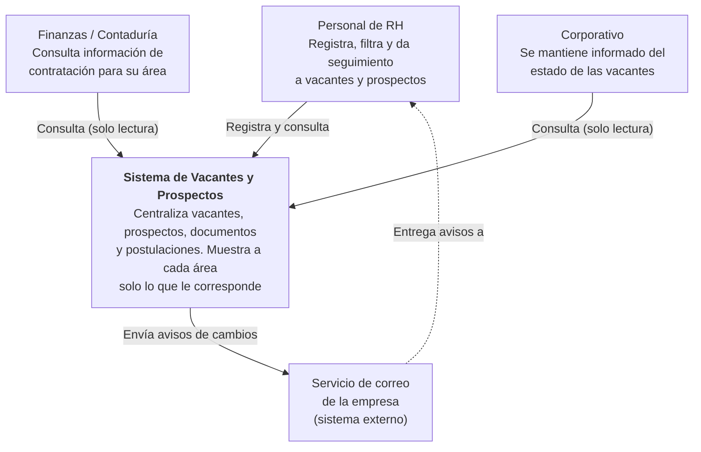
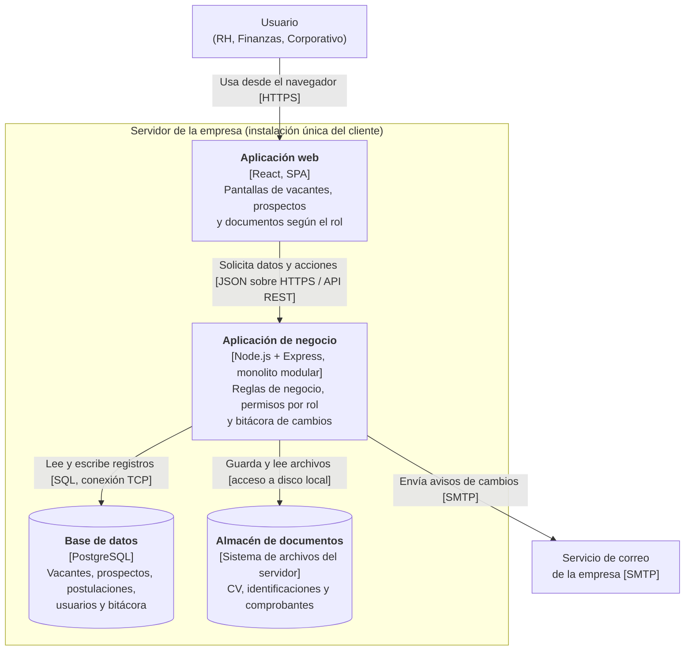

# Diagramas del Sistema de Vacantes y Prospectos de RH

Sistema de software instalado (un solo cliente) que centraliza vacantes, prospectos, documentos y postulaciones para el área de Recursos Humanos, con visibilidad controlada por rol para Finanzas/Contaduría y Corporativo.

## 1. Diagrama de contexto



---

## 2. Diagrama de contenedores



---

## 3. Diagrama de componentes

Interior de la Aplicación de negocio, el contenedor donde viven las reglas de negocio.

```mermaid
flowchart TB
    spa["<b>Aplicación web</b><br/>[React, SPA]"]
    bd[("Base de datos<br/>[PostgreSQL]")]
    archivos[("Almacén de documentos<br/>[Sistema de archivos]")]
    correo["Servicio de correo<br/>[SMTP]"]

        direction TB
        ctrl["<b>Capa de API</b><br/>Recibe las peticiones REST<br/>y valida los datos de entrada"]
        auth["<b>Módulo Usuarios y Roles</b><br/>Autentica y determina el rol<br/>(RH, Finanzas, Corporativo)"]
        vis["<b>Módulo Visibilidad por rol</b><br/>Decide qué campos y registros ve<br/>cada rol (Strategy por rol)"]
        pros["<b>Módulo Prospectos</b><br/>Alta, clasificación, verificación<br/>y filtrado de prospectos"]
        vac["<b>Módulo Vacantes</b><br/>Alta, urgencia, estado<br/>y filtrado de vacantes"]
        post["<b>Módulo Postulaciones</b><br/>Relaciona prospectos con vacantes<br/>y controla su avance"]
        docs["<b>Módulo Documentos</b><br/>Carga, verifica y recupera<br/>los documentos del prospecto"]
        bit["<b>Módulo Bitácora</b><br/>Registra quién cambió qué y cuándo<br/>(RNF-06)"]
        notif["<b>Módulo Notificaciones</b><br/>Avisa de cambios relevantes<br/>(Observer + Adapter de correo)"]
        repo["<b>Capa de Persistencia</b><br/>Acceso a base de datos<br/>y al almacén de documentos"]
    end

    spa -->|"JSON / HTTPS"| ctrl
    ctrl --> auth
    ctrl --> pros
    ctrl --> vac
    ctrl --> post
    ctrl --> docs
    pros --> vis
    vac --> vis
    post --> vis
    vis --> auth
    post --> pros
    post --> vac
    pros --> docs
    pros -->|"Publica cambios"| bit
    vac -->|"Publica cambios"| bit
    post -->|"Publica cambios"| bit
    pros -->|"Publica eventos"| notif
    vac -->|"Publica eventos"| notif
    post -->|"Publica eventos"| notif
    pros --> repo
    vac --> repo
    post --> repo
    docs --> repo
    bit --> repo
    auth --> repo
    repo -->|"SQL"| bd
    repo -->|"Acceso a disco"| archivos
    notif -->|"SMTP"| correo
```

---

