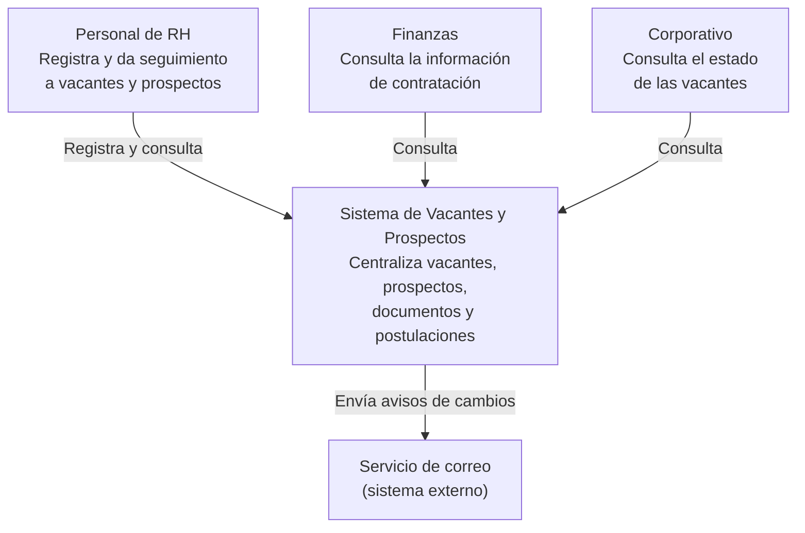
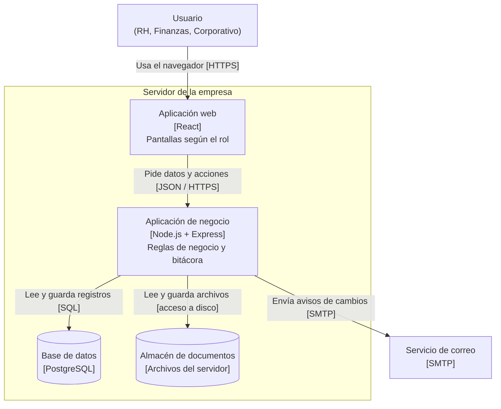
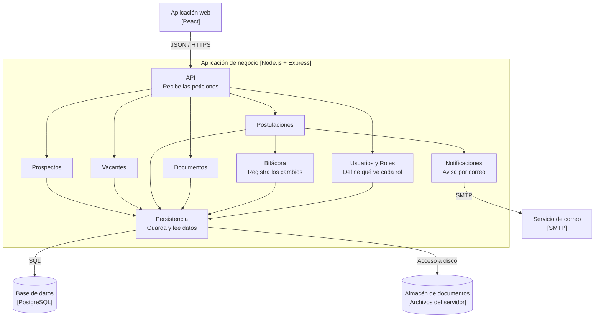

# Diagramas del Sistema de Vacantes y Prospectos de RH

Sistema de software instalado (un solo cliente) que centraliza vacantes, prospectos, documentos y postulaciones para el área de Recursos Humanos, con visibilidad controlada por rol para Finanzas/Contaduría y Corporativo.

## 1. Diagrama de contexto
 

 
---
 
## 2. Diagrama de contenedores
 

 
---
 
## 3. Diagrama de componentes
 

 
---
