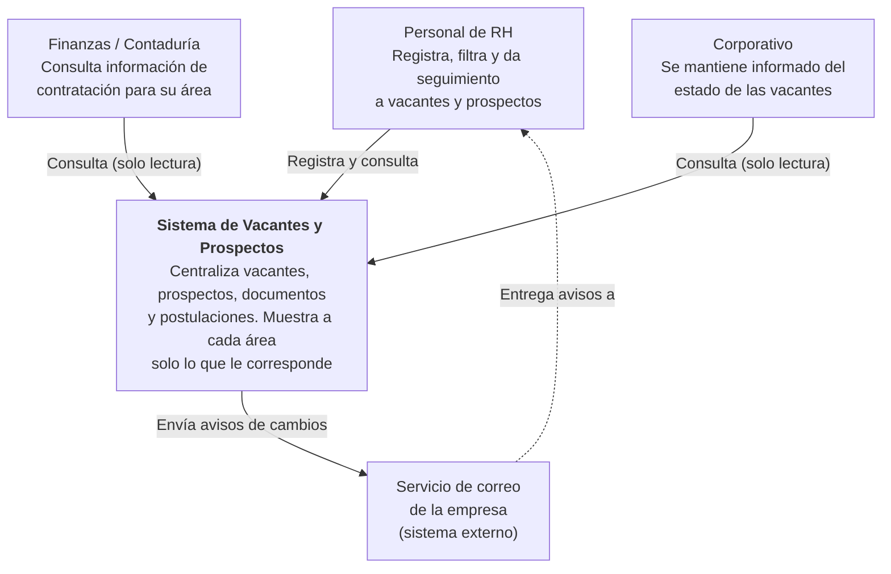
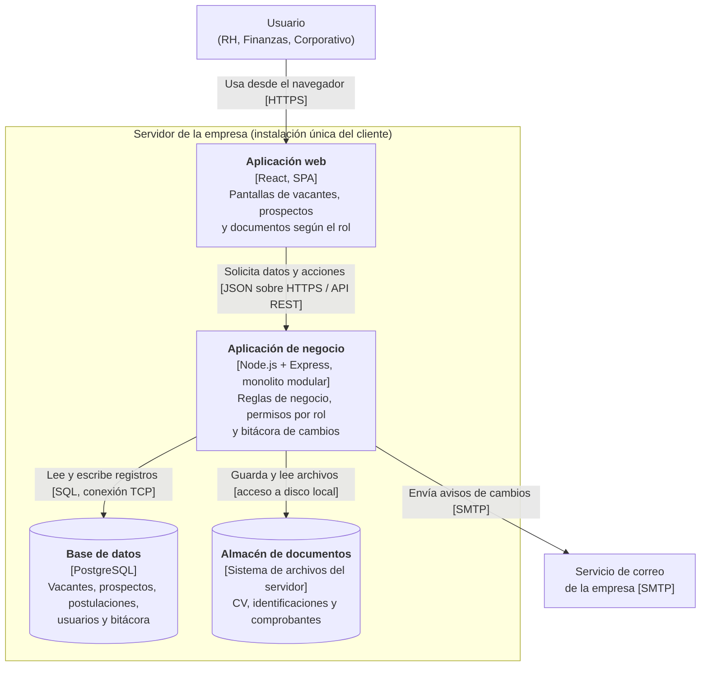
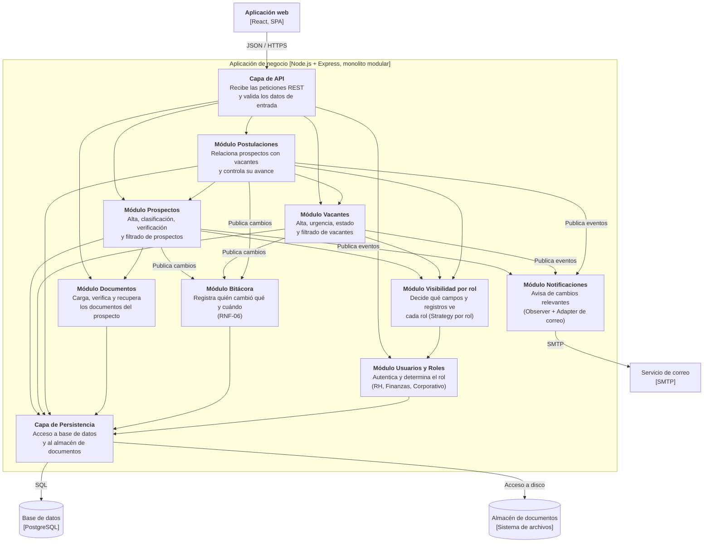
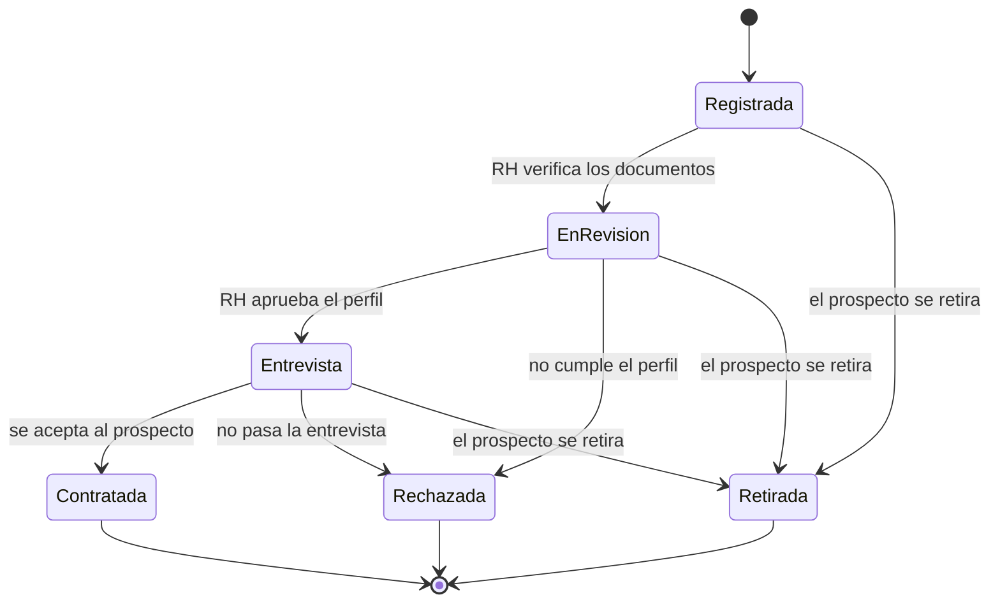
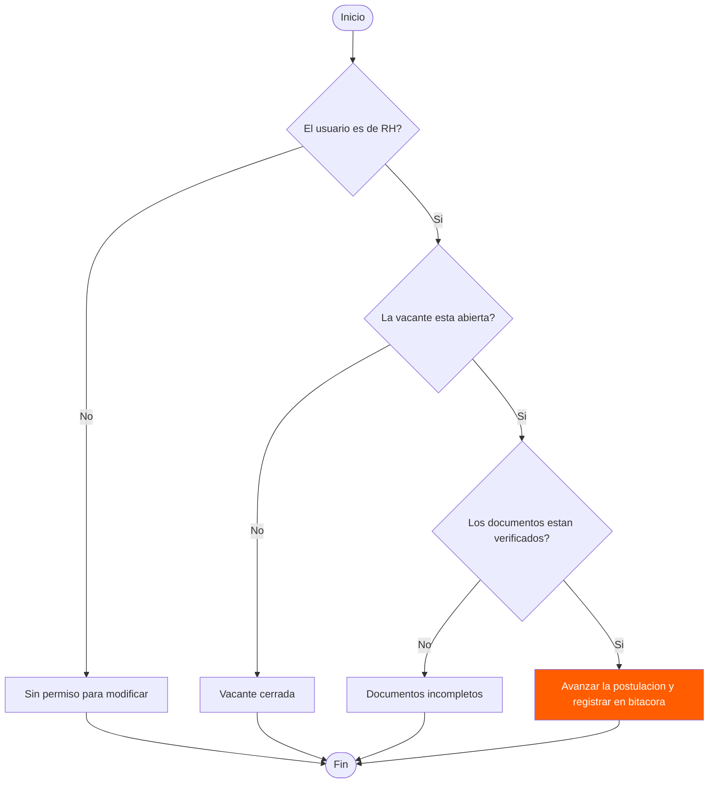
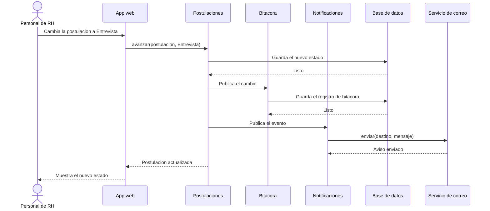

# Diagramas del Sistema de Vacantes y Prospectos de RH

Sistema de software instalado (un solo cliente) que centraliza vacantes, prospectos, documentos y postulaciones para el área de Recursos Humanos, con visibilidad controlada por rol para Finanzas/Contaduría y Corporativo.

## 1. Diagrama de contexto



---

## 2. Diagrama de contenedores



---

## 3. Diagrama de componentes

Interior de la Aplicación de negocio, el contenedor donde viven las reglas de negocio.



---

## 4. Diagrama de clases

```mermaid
classDiagram
class Empresa {
-nombre: string
-vacantes: List~Vacante~
+registrarVacante(vacante) void
+consultarVacantesAbiertas() List~Vacante~
}

class Vacante {
-puesto: string
-horario: string
-localidad: string
-urgencia: string
-estado: string
+cambiarEstado(estado) void
+estaAbierta() boolean
}

class Prospecto {
-nombre: string
-edad: int
-telefono: string
-correo: string
-escolaridad: string
-comentarios: string
+verificarDocumentos() boolean
+agregarDocumento(documento) void
}

class Documento {
-tipo: string
-archivo: string
-verificado: boolean
+marcarVerificado() void
}

class Postulacion {
-fecha: Date
-estado: string
+avanzar(nuevoEstado) void
}

class Usuario {
-nombre: string
-rol: string
-politica: PoliticaVisibilidad
+consultarProspecto(prospecto) Map
}

class PoliticaVisibilidad {
<<interface>>
+camposVisibles(prospecto) Map
}

class VisibilidadRH {
+camposVisibles(prospecto) Map
}

class VisibilidadFinanzas {
+camposVisibles(prospecto) Map
}

class VisibilidadCorporativo {
+camposVisibles(prospecto) Map
}

class RegistroBitacora {
-usuario: string
-accion: string
-fecha: Date
}

class Observador {
<<interface>>
+actualizar(evento) void
}

class Bitacora {
-registros: List~RegistroBitacora~
+actualizar(evento) void
}

class Notificador {
-servicio: ServicioCorreo
+actualizar(evento) void
}

class ServicioCorreo {
<<interface>>
+enviar(destino, mensaje) boolean
}

class AdaptadorSMTP {
+enviar(destino, mensaje) boolean
}

Empresa "1" --> "*" Vacante : publica
Vacante "1" --> "*" Postulacion : recibe
Prospecto "1" --> "*" Postulacion : realiza
Prospecto "1" --> "*" Documento : entrega
Usuario "1" --> "1" PoliticaVisibilidad : usa
PoliticaVisibilidad <|.. VisibilidadRH
PoliticaVisibilidad <|.. VisibilidadFinanzas
PoliticaVisibilidad <|.. VisibilidadCorporativo
Postulacion ..> Observador : notifica cambios
Observador <|.. Bitacora
Observador <|.. Notificador
Bitacora "1" --> "*" RegistroBitacora : guarda
Notificador "1" --> "1" ServicioCorreo : envía con
ServicioCorreo <|.. AdaptadorSMTP
```



---

## 5. Diagrama de estados: ciclo de vida de una postulación



---

## 6. Diagrama de flujo: validación al avanzar una postulación



---

## 7. Diagrama de secuencia: avanzar una postulación



---

## 8. Diagrama entidad-relación

```mermaid
erDiagram
EMPRESA ||--o{ VACANTE : publica
VACANTE ||--o{ POSTULACION : recibe
PROSPECTO ||--o{ POSTULACION : realiza
PROSPECTO ||--o{ DOCUMENTO : entrega
USUARIO ||--o{ BITACORA : genera
POSTULACION ||--o{ BITACORA : registra
EMPRESA {
int id
string nombre
}
VACANTE {
int id
string puesto
string horario
string localidad
string urgencia
string estado
}
PROSPECTO {
int id
string nombre
int edad
string telefono
string correo
string escolaridad
}
POSTULACION {
int id
date fecha
string estado
}
DOCUMENTO {
int id
string tipo
string archivo
boolean verificado
}
USUARIO {
int id
string nombre
string rol
}
BITACORA {
int id
string accion
date fecha
}
