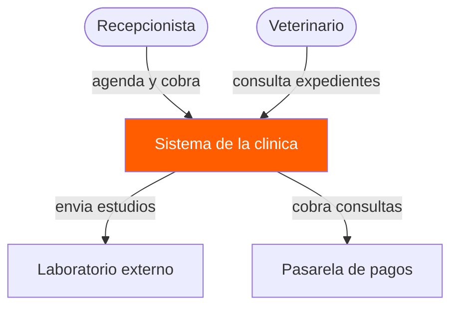
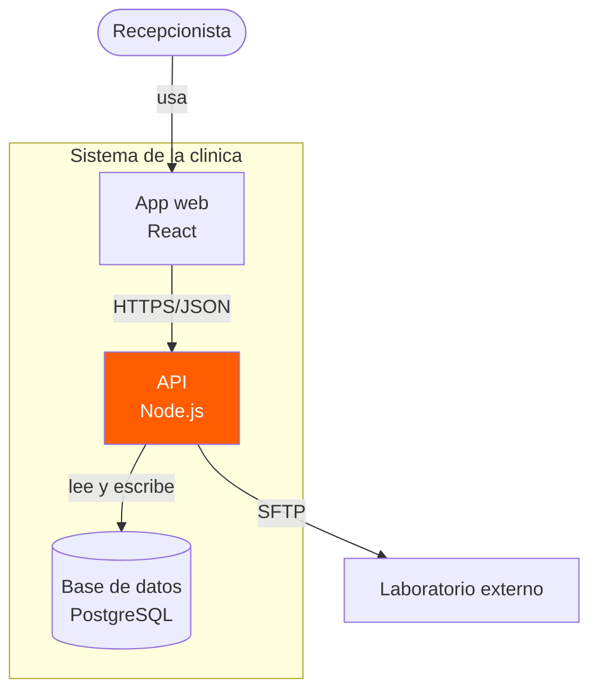
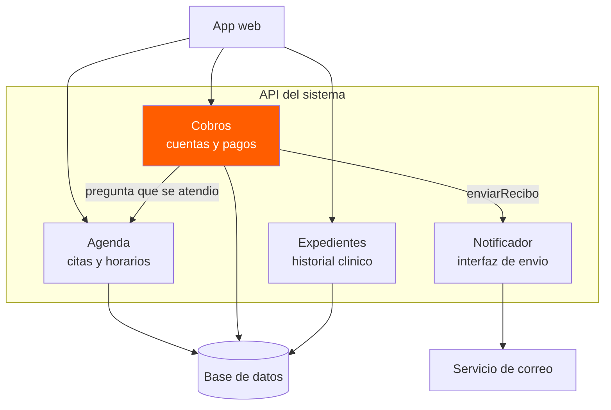
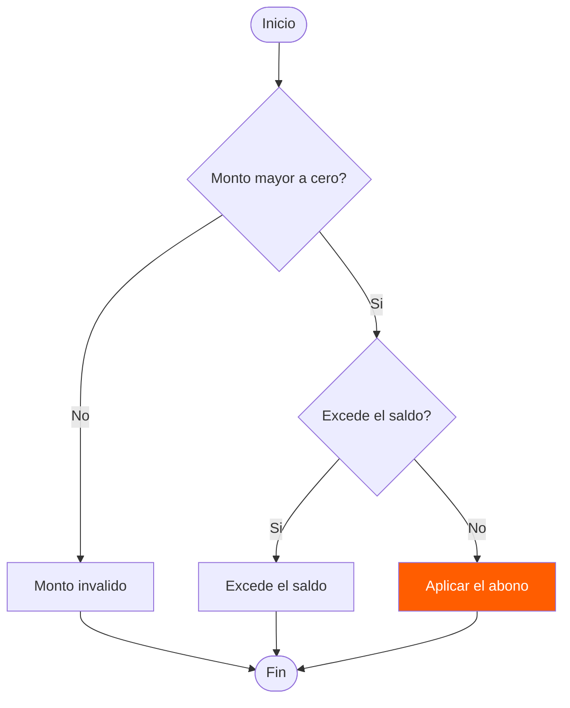
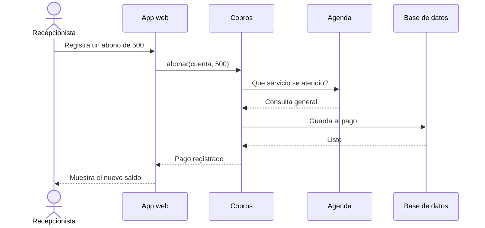
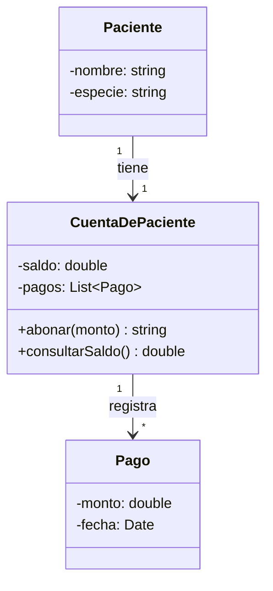
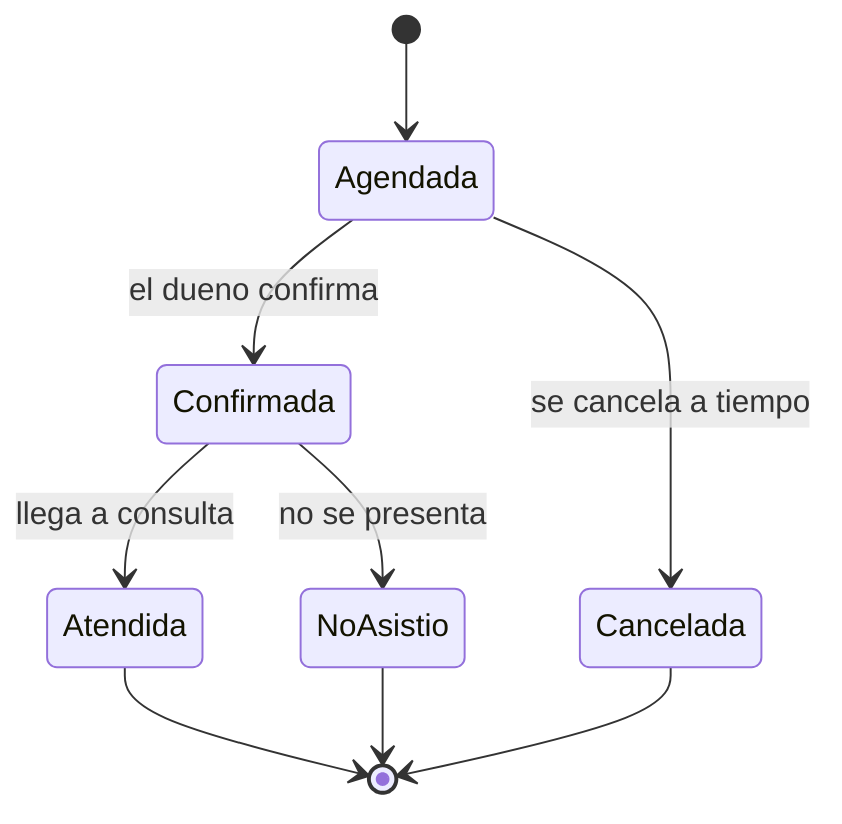
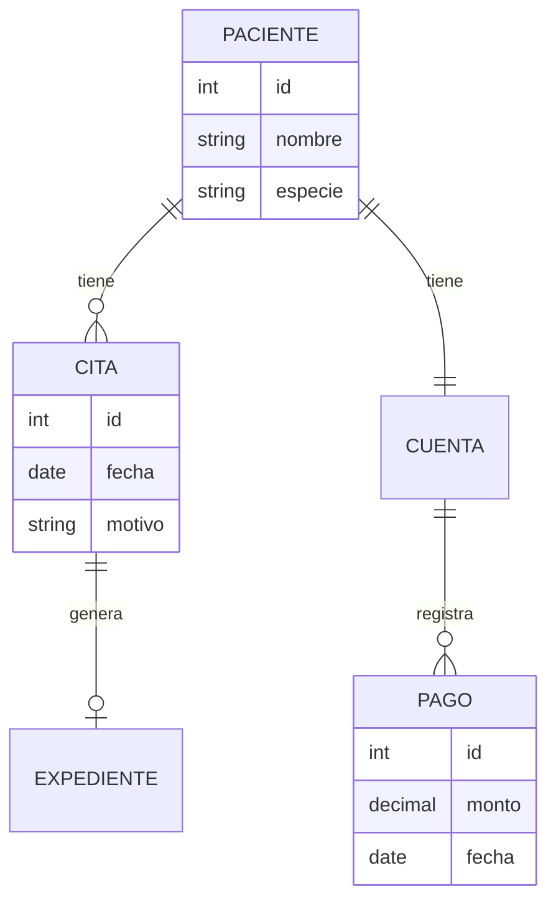

# Diagramas de guía de referencia Mermaid

## 1. Diagrama de contexto

---

## 2. Diagrama de contenedores

---

## 3. Diagrama de componentes

---

## 4. Diagrama de flujo con decisiones

---

## 5. Diagrama de secuencia

---

## 6. Diagrama de clases

---

## 7. Diagrama de estados

---

## 8. Diagrama entidad-relación

